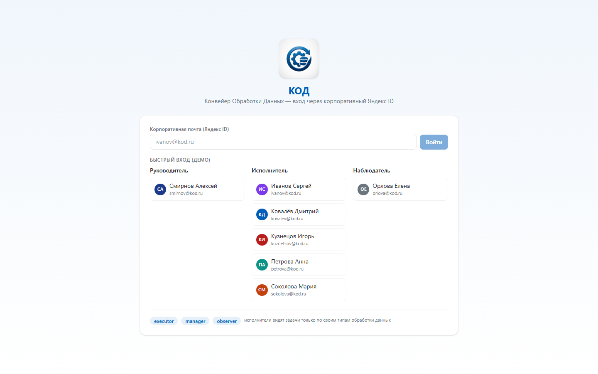

# КОД — Конвейер Обработки Данных

[](https://web-production-49600.up.railway.app/)

Дашборд-трекер для конвейерной (последовательной) обработки данных, реализованный по ТЗ `info/tz_data_tracker_KOD.txt`. Заказы приходят письмами (Яндекс.Почта), файлы лежат на Яндекс.Диске, этапы передаются по конвейеру между исполнителями по механике «захвата».

## Демо

**[https://web-production-49600.up.railway.app/](https://web-production-49600.up.railway.app/)**

На экране входа можно выбрать любого демо-пользователя одним кликом (пароль не требуется).

## Скриншоты

| Экран | Описание |
| --- | --- |
|  | Авторизация (мок Яндекс ID SSO), выбор демо-пользователя |
|  | «Мои задачи» — задачи исполнителя «в работе» с таймером и дедлайном |
|  | Канбан-доска конвейера по этапам с фильтрацией |
|  | Карточка проекта: таймлайн этапов, файлы и папки Яндекс.Диска |
|  | Аналитика по проектам, этапам, исполнителям и состоянию очереди |
|  | Управление сотрудниками и их навыками |
|  | Журнал интеграций Яндекс.Почта/Диск/Telegram и очередь заданий |

## Что реализовано

- **Ролевая модель**: `manager` (руководитель), `executor` (исполнитель), `observer` (наблюдатель)
- **Механика конвейера и захвата**: пул задач → «Взять в работу» → «Завершить» → активация следующего этапа; «Вернуть в пул» / «Сбросить захват»
- **Фильтрация по навыкам**: исполнитель видит и может взять только этапы своего типа обработки данных
- **Уведомления** (UI-колокольчик + мок-Telegram): новый этап, задача взята, дедлайн горит (<2 ч), просрочка
- **Фоновые воркеры**: монитор дедлайнов и очередь операций с ретраями
- **Интеграции (мок-адаптеры)**: Яндекс.Почта (IMAP/SMTP), Яндекс.Диск (REST/WebDAV), Telegram Bot API
- **Аудит**: действия пользователей (`logs`) и журнал вызовов интеграций

## Стек

- **Backend**: Node.js (`node:http`, `node:sqlite`, `node:crypto`) — без внешних зависимостей
- **Frontend**: React 19 + Vite + TailwindCSS v4
- **БД**: SQLite (`node:sqlite`), схема совместима с PostgreSQL
- **Дизайн**: сине-белая дизайн-система по ТЗ

## Демо-пользователи

| Роль | Почта | Типы обработки данных |
| --- | --- | --- |
| Руководитель | `smirnov@kod.ru` | все |
| Исполнитель | `kovalev@kod.ru` | Регистрация, Обработка данных |
| Исполнитель | `petrova@kod.ru` | Обработка данных |
| Исполнитель | `ivanov@kod.ru` | Обработка данных, Аналитика |
| Исполнитель | `sokolova@kod.ru` | Аналитика, Формирование заключения |
| Исполнитель | `kuznetsov@kod.ru` | Контроль качества |
| Наблюдатель | `orlova@kod.ru` | — |

## Локальный запуск

```bash
npm run setup      # установка зависимостей фронтенда
npm run dev        # API на http://localhost:8000 + UI на http://localhost:5173
```

Продакшн-режим (одним портом):
```bash
npm run start      # сборка фронтенда и запуск на http://localhost:8000
```

## Деплой

Проект развёрнут на [Railway](https://railway.app/) с конфигурацией `Procfile` и `railway.json`. Для запуска используется `npm start`, который собирает фронтенд и отдаёт и API, и статические файлы с одного порта.

## Структура проекта

```
server/   # API, бизнес-логика, воркеры, интеграции
web/      # React + Vite фронтенд
info/     # ТЗ и логотип
scripts/  # скрипты запуска
screenshots/ # скриншоты приложения
```

## Соответствие ТЗ

Реализованы все ключевые сценарии приёмки: приём письма с вложениями → создание проекта и папок на Яндекс.Диске, конкурентный захват задач, активация следующего этапа с уведомлениями, отправка результата клиенту по почте со ссылками на Диск.
